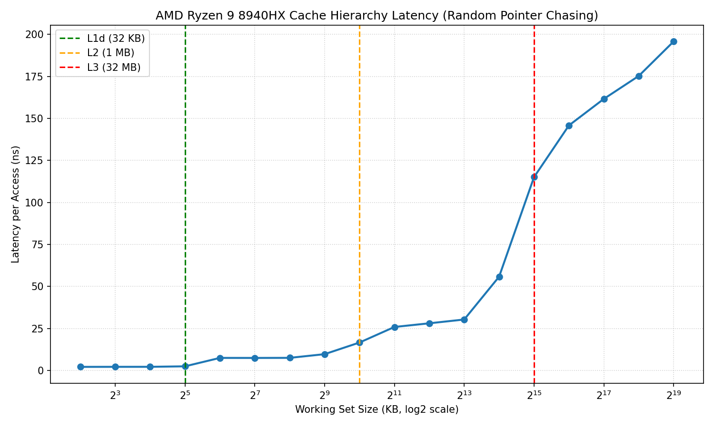

# Experiment 4: Cache Hierarchy Measurement (Random Pointer Chasing)

## 1. Goal
Measure the real memory access latency of the AMD Ryzen 9 8940HX across L1, L2, L3 caches, and main RAM by sweeping working set sizes from 4 KB to 512 MB using random pointer chasing.

## 2. COA Concepts
- **Memory Hierarchy (L1 / L2 / L3 / RAM):** Smaller caches sit closer to the CPU core with much lower latency; larger tiers trade speed for capacity.
- **Cache Line (64 bytes):** The minimum unit of data transferred between memory tiers.
- **Hardware Prefetching:** Modern CPUs detect sequential memory patterns and speculatively fetch upcoming cache lines, hiding true latency.
- **Random Pointer Chasing:** Linking 64-byte nodes in a single random cycle (`p = p->next`) creates a serial data dependency that defeats hardware prefetching and exposes true per-access latency.
- **TLB (Translation Lookaside Buffer) Misses:** At very large working sets (64 MB–512 MB), random jumps also miss the TLB, adding page-table walk latency on top of RAM access time.

## 3. Method
1. Queried actual hardware cache sizes on the Ryzen 9 8940HX using `lscpu -C`:
   - **L1d:** 32 KB per core (8-way, 64-byte line)
   - **L2:** 1 MB per core (8-way, 64-byte line)
   - **L3:** 32 MB shared (16-way, 64-byte line)
2. Implemented `cache_latency.c` using 64-byte aligned `Node` structs (1 node = 1 cache line) linked into a single random cycle via Sattolo's algorithm.
3. Performed 5,000,000 pointer-chasing hops per working set size from 4 KB to 512 MB, using a `volatile uintptr_t` sink to prevent `-O3` dead-code elimination.
4. Recorded per-access latency in nanoseconds into `results.csv` and plotted the staircase curve in `cache_latency.png` using `plot_cache.py`.

## 4. Commands

    # Inspect hardware cache hierarchy
    lscpu -C

    # Compile and run benchmark
    gcc -O3 cache_latency.c -o cache_latency
    ./cache_latency | tee results.csv

    # Generate latency graph
    python3 plot_cache.py

## 5. Results
Measured latency per access on AMD Ryzen 9 8940HX (WSL2 Ubuntu) is saved in `results.csv` and plotted below:

## 6. Latency Table

| Working Set Size | Latency (ns) | Dominant Memory Tier |
| :--- | :--- | :--- |
| 4 KB | 2.11 | L1d Cache (32 KB) |
| 8 KB | 2.14 | L1d Cache |
| 16 KB | 2.15 | L1d Cache |
| 32 KB | 2.44 | L1d Cache boundary |
| 64 KB | 7.45 | L2 Cache (1 MB) |
| 128 KB | 7.43 | L2 Cache |
| 256 KB | 7.48 | L2 Cache |
| 512 KB | 9.68 | L2 Cache |
| 1024 KB (1 MB) | 16.60 | L2 → L3 transition |
| 2048 KB (2 MB) | 25.86 | L3 Cache (32 MB) |
| 4096 KB (4 MB) | 28.05 | L3 Cache |
| 8192 KB (8 MB) | 30.31 | L3 Cache |
| 16384 KB (16 MB) | 55.80 | L3 → RAM transition |
| 32768 KB (32 MB) | 115.04 | Main RAM (shared L3 contention) |
| 65536 KB (64 MB) | 145.82 | Main RAM + TLB misses |
| 131072 KB (128 MB) | 161.60 | Main RAM + TLB misses |
| 262144 KB (256 MB) | 175.26 | Main RAM + TLB misses |
| 524288 KB (512 MB) | 195.79 | Main RAM + TLB misses |

## 7. Explanation of Results
- **L1d Plateau (4–32 KB, ~2.1–2.4 ns):** The entire working set fits inside the 32 KB L1 data cache.
- **L2 Jump (64–512 KB, ~7.4–9.7 ns):** Crossing 32 KB causes a ~3.5× latency jump as accesses spill into the 1 MB L2 cache.
- **L3 Jump (2–8 MB, ~25.9–30.3 ns):** Crossing 1 MB pushes accesses into the shared 32 MB L3 cache.
- **RAM + TLB Region (32–512 MB, ~115–196 ns):** Because the 32 MB L3 cache is shared with the OS and WSL2, a 32 MB random working set already spills heavily into main RAM. At 64–512 MB, random jumps also trigger TLB misses, pushing latency to 195.79 ns (~93× slower than L1).

## 8. Limitations
- Executed inside WSL2 on Windows 11, where background OS activity and virtualization can introduce minor noise and shared L3 contention.
- Standard 4 KB memory pages were used (not HugePages), so latencies above 64 MB include both DRAM access time and TLB page-walk overhead.
- Thread was not pinned to a single physical core (`taskset`), though single-threaded execution remained consistent across the sweep.
