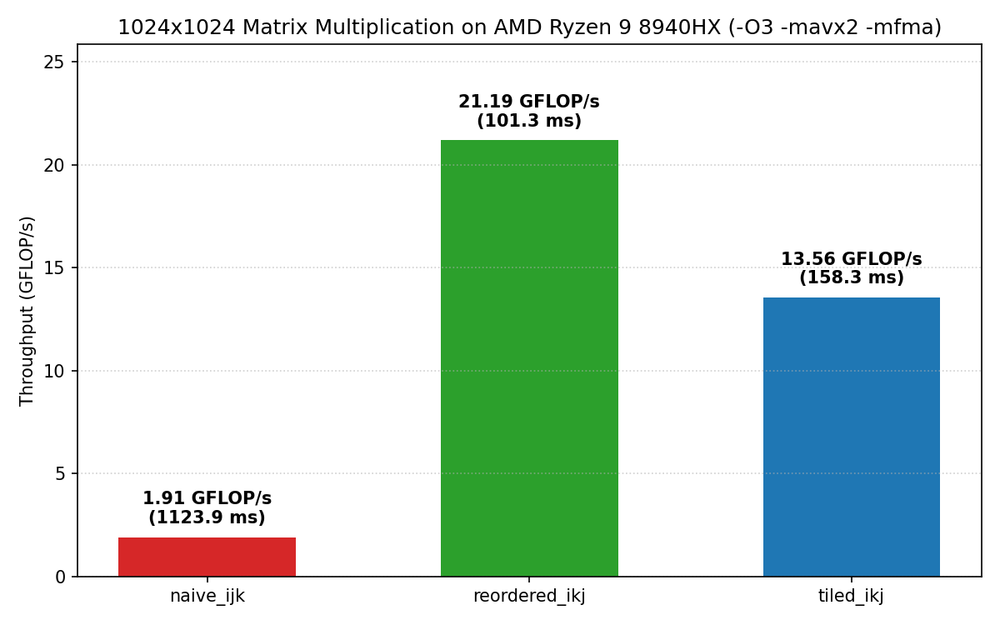

# Experiment 5: Matrix Multiplication (Loop Order & Cache Tiling)

## 1. Goal
Benchmark three implementations of $1024 \times 1024$ single-precision matrix multiplication ($C = A \times B$) on the AMD Ryzen 9 8940HX—naive `i-j-k`, loop-reordered `i-k-j`, and $64 \times 64$ cache-tiled `i-k-j`—to measure how memory access patterns and cache locality affect throughput.

## 2. COA Concepts
- **Row-Major Layout:** In C, 2D matrices are stored row by row in contiguous memory. Accessing consecutive columns (`j++`) achieves **stride-1 spatial locality**, utilizing all 16 floats inside each 64-byte cache line.
- **Strided Column Access (Cache Thrashing):** Walking down a column (`B[k][j]` as `k` increments) jumps by $N \times 4 = 4{,}096$ bytes per step, causing frequent cache misses and preventing effective SIMD vectorization.
- **Hardware Prefetching & SIMD:** Stride-1 row traversal allows the CPU's hardware prefetcher to stream upcoming cache lines and enables GCC (`-O3 -mavx2 -mfma`) to auto-vectorize the inner loop with 256-bit AVX2 FMA instructions.
- **Cache Tiling (Blocking):** Partitioning matrices into smaller sub-blocks (tiles) improves **temporal locality** when matrices exceed cache capacity, though it adds loop-control overhead and shortens inner-loop trip counts.

## 3. Method
1. Implemented three $1024 \times 1024$ (`float`) matrix multiplication variants in `matmul.c` using `aligned_alloc(64, ...)` and `restrict` pointers:
   - `naive_ijk`: Standard `i-j-k` order (column-wise access on `B`).
   - `reordered_ikj`: Swapped inner loops (`i-k-j`) for stride-1 row access on `B` and `C`.
   - `tiled_ikj`: Blocked `i-k-j` with `TILE = 64` ($64 \times 64$ float tiles = 16 KB each).
2. Compiled with `gcc -O3 -mavx2 -mfma matmul.c -o matmul -lm` and ran `./matmul | tee results.csv`.
3. Verified numerical correctness across all three variants via `max_diff` against `naive_ijk`.
4. Plotted throughput (GFLOP/s) and runtime (ms) in `matmul_perf.png` using `plot_matmul.py`.

## 4. Commands

    # Compile with AVX2 + FMA optimization
    gcc -O3 -mavx2 -mfma matmul.c -o matmul -lm

    # Run benchmark and save results
    ./matmul | tee results.csv

    # Generate performance bar chart
    python3 plot_matmul.py

## 5. Results
Measured single-threaded performance on AMD Ryzen 9 8940HX (WSL2 Ubuntu) is saved in `results.csv` and plotted below:

## 6. Performance Table

| Variant | Matrix Size | Tile Size | Time (ms) | Throughput (GFLOP/s) | Speedup vs. Naive | Max Diff |
| :--- | :--- | :--- | :--- | :--- | :--- | :--- |
| `naive_ijk` | 1024 × 1024 | — | 1123.90 | 1.91 | 1.0× | 0.000000 |
| `reordered_ikj` | 1024 × 1024 | — | 101.33 | 21.19 | **11.1×** | 0.000076 |
| `tiled_ikj` | 1024 × 1024 | 64 × 64 | 158.35 | 13.56 | **7.1×** | 0.000076 |

## 7. Explanation of Results
- **11.1× Speedup from Loop Reordering:** Swapping the `j` and `k` loops (`naive_ijk` → `reordered_ikj`) cut runtime from **1123.90 ms** down to **101.33 ms** (1.91 → 21.19 GFLOP/s). Eliminating 4,096-byte strided column accesses on `B` unlocked both hardware prefetching and 256-bit AVX2/FMA vectorization.
- **Why Untiled `i-k-j` Beat 64×64 Tiling at $N = 1024$:** Each $1024 \times 1024$ float matrix is 4 MB, so all three matrices (12 MB total) fit comfortably inside the Ryzen 9 8940HX's **32 MB L3 cache**, and one row of `C` (4 KB) fits inside the **32 KB L1d cache**. Tiling with `TILE = 64` shortened the inner loop to 64 floats (8 AVX2 vectors), adding loop overhead and interrupting long sequential prefetch streams without saving main-RAM trips.
- **Numerical Accuracy:** The tiny `max_diff` of `0.000076` is expected floating-point non-associativity from changing the summation order.

## 8. Limitations
- Executed single-threaded on one CPU core; multi-threading (OpenMP) and register blocking would push throughput significantly higher.
- Tested at a single matrix size ($N = 1024$) where the working set fits inside L3 cache; larger matrices ($N = 2048$ or $4096$) that spill into main RAM would demonstrate the regime where cache tiling overtakes untiled `i-k-j`.
