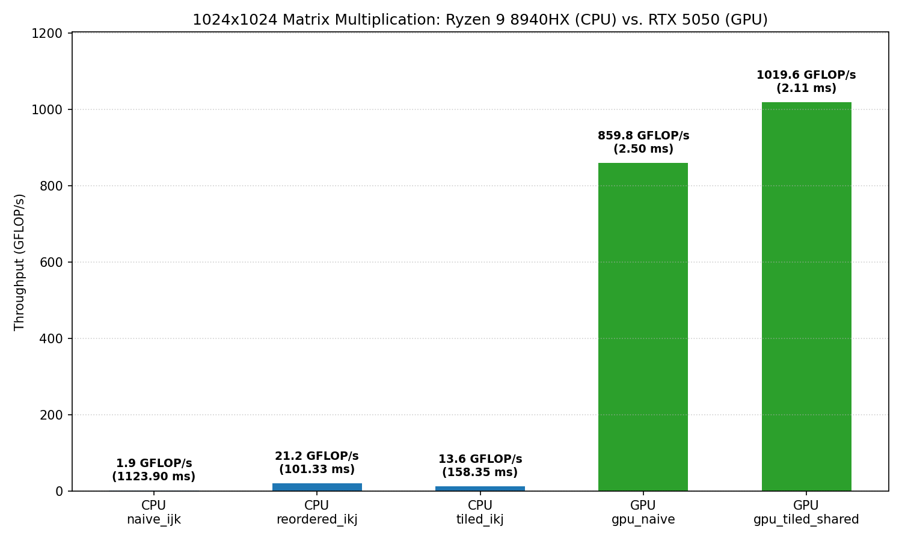

# Experiment 6: GPU Matrix Multiplication (Global Memory vs. Shared-Memory Tiling)

## 1. Goal
Benchmark $1024 \times 1024$ single-precision matrix multiplication ($C = A \times B$) on the NVIDIA RTX 5050 Laptop GPU using a naive Global Memory kernel and a $16 \times 16$ Shared-Memory tiled kernel, and compare the results directly against the AMD Ryzen 9 8940HX CPU benchmarks from Experiment 5.

## 2. COA Concepts
- **Massive SIMT Parallelism:** Launching a $64 \times 64$ grid of $16 \times 16$ thread blocks spawns $1{,}048{,}576$ GPU threads—one per output element of $C$—hiding memory latency via warp scheduling.
- **Global Memory (VRAM):** High-capacity, high-bandwidth off-chip memory with high access latency; naive kernels repeatedly fetch the same matrix elements across threads.
- **Shared Memory (`__shared__`):** Fast, programmer-managed on-chip SRAM shared by all threads within a thread block. Staging $16 \times 16$ tiles in Shared Memory reduces Global Memory traffic by up to $16\times$.
- **Block Synchronization (`__syncthreads()`):** Ensures all threads in a block finish loading a tile into Shared Memory before computing partial products, and finish computing before overwriting the tile.

## 3. Method
1. Implemented two CUDA kernels in `matmul_gpu.cu` for $N = 1024$:
   - `gpu_naive`: Each thread computes one element of `C` by reading directly from Global VRAM.
   - `gpu_tiled_shared`: Uses $16 \times 16$ thread blocks and `__shared__` memory tiles (`tileA[16][16]`, `tileB[16][16]`).
2. Compiled with `nvcc -O3 matmul_gpu.cu -o matmul_gpu`.
3. Performed a warm-up kernel launch, then timed both kernels using hardware `cudaEvent_t` timers and verified numerical equivalence (`max_diff = 0.000000`).
4. Saved GPU measurements to `results.csv` and plotted the full CPU vs. GPU comparison in `gpu_matmul_perf.png` using `plot_gpu_matmul.py`.

## 4. Commands

    # Compile CUDA kernels
    nvcc -O3 matmul_gpu.cu -o matmul_gpu

    # Run benchmark and save results
    ./matmul_gpu | tee results.csv

    # Generate CPU vs. GPU comparison chart
    python3 plot_gpu_matmul.py

## 5. Results
Measured GPU kernel performance on NVIDIA RTX 5050 Laptop GPU (WSL2 Ubuntu) is saved in `results.csv` and compared against Experiment 5 CPU results below:

## 6. CPU vs. GPU Comparison Table

| Hardware & Variant | Tile Size | Time (ms) | Throughput (GFLOP/s) | Speedup vs. Naive CPU | Max Diff |
| :--- | :--- | :--- | :--- | :--- | :--- |
| CPU `naive_ijk` (Exp 5) | — | 1123.90 | 1.91 | 1.0× | 0.000000 |
| CPU `tiled_ikj` (Exp 5) | 64 × 64 | 158.35 | 13.56 | 7.1× | 0.000076 |
| CPU `reordered_ikj` (Exp 5) | — | 101.33 | 21.19 | 11.1× | 0.000076 |
| **GPU `gpu_naive`** | — | **2.498** | **859.82** | **449.9×** | 0.000000 |
| **GPU `gpu_tiled_shared`** | 16 × 16 | **2.106** | **1019.64** | **533.7×** | 0.000000 |

## 7. Explanation of Results
- **48.1× Over Best Single-Threaded CPU:** `gpu_tiled_shared` reached **1019.64 GFLOP/s** (2.106 ms), crossing 1 TFLOP/s and running 48.1× faster than the best single-threaded AVX2+FMA CPU implementation (21.19 GFLOP/s).
- **Shared-Memory Tiling Gain (+18.6%):** Moving from `gpu_naive` (859.82 GFLOP/s) to `gpu_tiled_shared` (1019.64 GFLOP/s) improved throughput by ~19%. Because each $1024 \times 1024$ matrix is only 4 MB, the RTX 5050's on-chip L2 cache already absorbed much of `gpu_naive`'s repeated reads; explicit Shared Memory staging still reduced L2 pressure and improved data reuse.
- **Exact Match:** `max_diff` between `gpu_naive` and `gpu_tiled_shared` was `0.000000` because both accumulate along `k = 0..1023` in the same order.

## 8. Limitations
- Timings measure pure GPU kernel execution (`cudaEvent_t`) and exclude host-to-device / device-to-host PCIe transfer overhead (`cudaMemcpy`).
- CPU baseline from Experiment 5 was single-threaded; a multi-threaded OpenMP or vendor BLAS (`OpenBLAS` / `cuBLAS` Tensor Core) comparison would push both CPU and GPU ceilings much higher.
