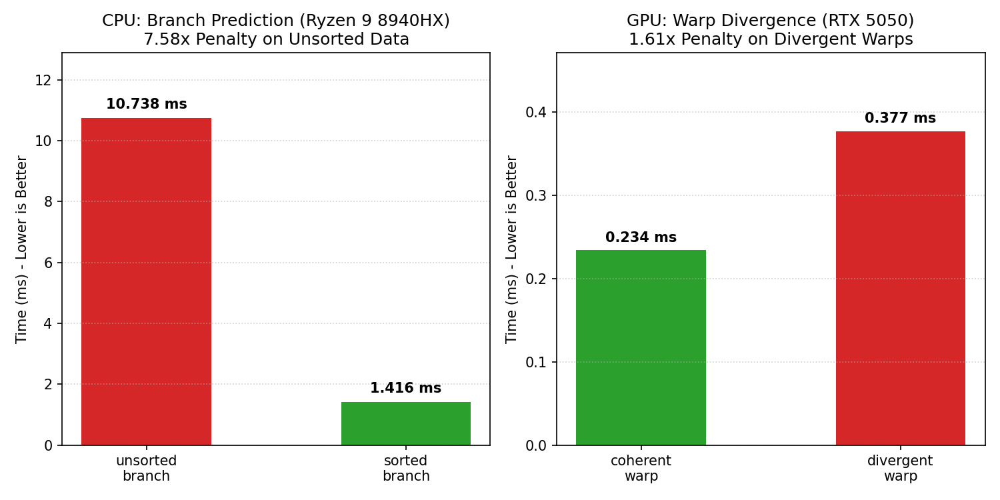

# Experiment 7: CPU Branch Prediction vs. GPU Warp Divergence

## 1. Goal
Measure how conditional control flow (`if/else`) affects execution speed on two fundamentally different architectures:
- **CPU (AMD Ryzen 9 8940HX):** Speculative execution with hardware branch prediction (sorted vs. unsorted data).
- **GPU (NVIDIA RTX 5050 Laptop GPU):** Lockstep SIMT execution in 32-thread warps (warp-coherent vs. warp-divergent branching).

## 2. COA Concepts
- **Pipeline & Branch Prediction (CPU):** Modern CPUs execute instructions in deep, out-of-order pipelines and speculatively guess branch outcomes. A **branch misprediction** forces a pipeline flush, wasting ~15–20 clock cycles per miss.
- **Compiler If-Conversion & Auto-Vectorization:** At `-O2`/`-O3`, GCC automatically replaces simple branches with branchless SIMD instructions or `cmov`. Disabling these (`-fno-tree-vectorize -fno-tree-loop-if-convert -fno-if-conversion -fno-if-conversion2`) exposes the true hardware branch penalty.
- **SIMT Warp Execution (GPU):** A GPU schedules threads in lockstep groups of 32 (**warps**). When all 32 threads take the same branch (**coherent**), the warp executes at full efficiency.
- **Warp Divergence:** When threads *within the same warp* take different `if/else` paths, the GPU must execute both paths serially while masking off inactive threads, reducing effective throughput.

## 3. Method
1. **CPU (`branch_cpu.c`):** Generated 16,000,000 random `uint8_t` values (`0–255`), timed a conditional sum (`if (data[i] >= 128)`) averaged over 10 repetitions on the unsorted array, sorted the array with `qsort`, and timed the exact same loop on the sorted array.
2. **GPU (`divergence_gpu.cu`):** Launched 16,000,000 threads running a 64-iteration arithmetic `if/else` loop under two conditions:
   - `coherent_warp`: `(tid / 32) % 2 == 0` (all 32 threads in each warp take the same path).
   - `divergent_warp`: `tid % 2 == 0` (even/odd threads inside every warp split paths).
3. Timed GPU kernels with hardware `cudaEvent_t` timers and saved all measurements to `results.csv`.
4. Generated the side-by-side comparison chart `branch_vs_divergence.png` using `plot_branch.py`.

## 4. Commands

    # Compile and run CPU branch prediction benchmark
    gcc -O2 -fno-tree-vectorize -fno-tree-loop-if-convert -fno-if-conversion -fno-if-conversion2 branch_cpu.c -o branch_cpu
    ./branch_cpu | tee results.csv

    # Compile and run GPU warp divergence benchmark (append to results.csv)
    nvcc -O3 divergence_gpu.cu -o divergence_gpu
    ./divergence_gpu | tee -a results.csv

    # Generate comparison chart
    python3 plot_branch.py

## 5. Results
Measured timings on AMD Ryzen 9 8940HX and NVIDIA RTX 5050 Laptop GPU are saved in `results.csv` and plotted below:

## 6. Performance Table

| Device | Case | Time (ms) | Relative Penalty | Checksum |
| :--- | :--- | :--- | :--- | :--- |
| CPU (Ryzen 9 8940HX) | `sorted_branch` | 1.416 | 1.00× (baseline) | 15316398560 |
| CPU (Ryzen 9 8940HX) | `unsorted_branch` | 10.738 | **7.58× slower** | 15316398560 |
| GPU (RTX 5050) | `coherent_warp` | 0.234 | 1.00× (baseline) | — |
| GPU (RTX 5050) | `divergent_warp` | 0.377 | **1.61× slower** | — |

## 7. Explanation of Results
- **CPU Branch Misprediction (7.58× penalty):** Both CPU runs processed the exact same 16 million bytes and produced the identical checksum (`15316398560`). On sorted data, the hardware branch predictor was nearly 100% accurate (`1.416 ms`). On unsorted data, ~50% random mispredictions repeatedly flushed the pipeline, inflating runtime to `10.738 ms`. (When auto-vectorization was left enabled at default `-O2`, both runs took ~0.95 ms because GCC eliminated the branch entirely.)
- **GPU Warp Divergence (1.61× penalty):** Splitting even and odd threads inside every 32-thread warp forced the RTX 5050 to serialize both branches (`0.234 ms` → `0.377 ms`). The penalty is 1.61× rather than a pure 2.0× because fixed kernel launch and global memory write overhead are shared by both runs.

## 8. Limitations
- CPU and GPU workloads differ in arithmetic intensity (memory-bound conditional sum vs. compute-bound 64-iteration loop) to cleanly isolate each architecture's control-flow mechanism; absolute times are compared within each device rather than across devices.
- GPU timings measure kernel execution via `cudaEvent_t` and exclude PCIe transfer overhead.
