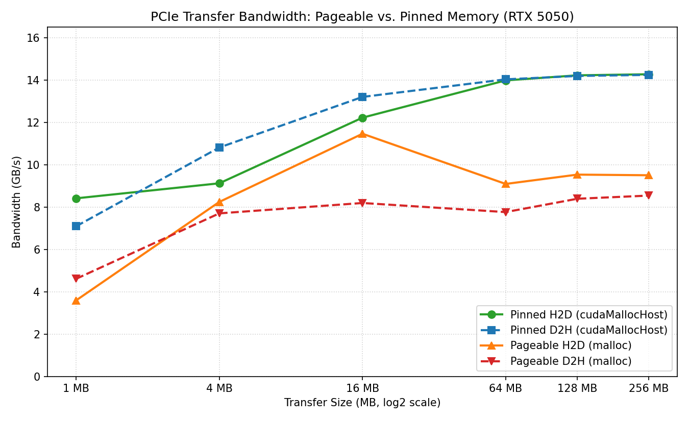

# Experiment 8: The PCIe Bottleneck (Pageable vs. Pinned Memory Bandwidth)

## 1. Goal
Measure Host-to-Device (H2D) and Device-to-Host (D2H) PCIe transfer bandwidth between the AMD Ryzen 9 8940HX host RAM and NVIDIA RTX 5050 Laptop GPU VRAM across transfer sizes from 1 MB to 256 MB, comparing standard **pageable** memory (`malloc`) against **pinned** (page-locked) memory (`cudaMallocHost`).

## 2. COA Concepts
- **PCIe Bus Bottleneck:** Discrete GPUs sit across the PCIe interconnect, whose bandwidth (~14–16 GB/s on a PCIe Gen4 ×8 laptop link) is an order of magnitude lower than on-card GPU VRAM bandwidth. For small or memory-bound workloads, data transfer time can rival or exceed GPU compute time.
- **Pageable Memory (`malloc`):** Standard OS virtual memory pages can be relocated or swapped to disk, so the GPU's DMA (Direct Memory Access) engine cannot read them directly. CUDA must first copy the data into an internal pinned staging buffer in RAM before initiating the DMA transfer, cutting effective bandwidth.
- **Pinned / Page-Locked Memory (`cudaMallocHost`):** Locks pages in physical RAM so the GPU's DMA engine can stream data directly over PCIe at full hardware link speed.

## 3. Method
1. Implemented `pcie_bench.cu` to sweep transfer sizes (`1, 4, 16, 64, 128, 256` MB) for both `pageable` and `pinned` host buffers.
2. Performed a warm-up transfer, then timed 5 repetitions each of Host-to-Device (`cudaMemcpyHostToDevice`) and Device-to-Host (`cudaMemcpyDeviceToHost`) using hardware `cudaEvent_t` timers.
3. Compiled with `nvcc -O3 pcie_bench.cu -o pcie_bench`, ran `./pcie_bench | tee results.csv`, and plotted all four bandwidth curves in `pcie_bandwidth.png` via `plot_pcie.py`.

## 4. Commands

    # Compile CUDA PCIe benchmark
    nvcc -O3 pcie_bench.cu -o pcie_bench

    # Run benchmark and save results
    ./pcie_bench | tee results.csv

    # Generate bandwidth comparison chart
    python3 plot_pcie.py

## 5. Results
Measured PCIe transfer bandwidth on AMD Ryzen 9 8940HX + NVIDIA RTX 5050 Laptop GPU (WSL2 Ubuntu) is saved in `results.csv` and plotted below:

## 6. Bandwidth Summary Table (Selected Sizes)

| Transfer Size | Pageable H2D (GB/s) | Pinned H2D (GB/s) | Pageable D2H (GB/s) | Pinned D2H (GB/s) | Pinned Speedup (H2D / D2H) |
| :--- | :--- | :--- | :--- | :--- | :--- |
| **1 MB** | 3.59 | 8.41 | 4.61 | 7.09 | 2.34× / 1.54× |
| **4 MB** | 8.24 | 9.12 | 7.70 | 10.81 | 1.11× / 1.40× |
| **16 MB** | 11.46 | 12.22 | 8.19 | 13.20 | 1.07× / 1.61× |
| **64 MB** | 9.09 | 13.98 | 7.76 | 14.03 | 1.54× / 1.81× |
| **128 MB** | 9.53 | 14.22 | 8.39 | 14.19 | 1.49× / 1.69× |
| **256 MB** | 9.50 | **14.27** | 8.54 | **14.24** | **1.50× / 1.67×** |

## 7. Explanation of Results
- **Hardware Link Ceiling:** Pinned memory saturates at **14.27 GB/s (H2D)** and **14.24 GB/s (D2H)** for 256 MB transfers—matching the practical throughput ceiling of a **PCIe Gen4 ×8** laptop GPU link (~15.75 GB/s theoretical minus protocol overhead).
- **1.50×–1.67× Pinned Advantage:** Eliminating CUDA's internal CPU-side staging copy boosts sustained H2D bandwidth from 9.50 → 14.27 GB/s and D2H from 8.54 → 14.24 GB/s.
- **Connection to Experiment 6 (GPU MatMul):** Each $1024 \times 1024$ float matrix in Experiment 6 is **4 MB**. Transferring `A` and `B` to the GPU (2 × 0.509 ms) and copying `C` back (0.544 ms) with pageable memory takes **~1.56 ms**—nearly as long as the entire **2.106 ms** shared-memory GPU matrix multiplication kernel. This illustrates why keeping data resident in VRAM (or overlapping transfers with compute via CUDA streams) is critical in real GPU applications.

## 8. Limitations
- Measured synchronous `cudaMemcpy` calls on a single stream; asynchronous transfers (`cudaMemcpyAsync`) with multiple CUDA streams can overlap H2D/D2H transfers with kernel execution to hide latency.
- Executed inside WSL2, which adds a small virtualization layer over Windows WDDM/DMA scheduling compared to bare-metal Linux.
