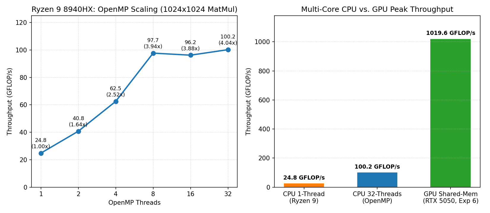

# Experiment 9: Multi-Core CPU (OpenMP) vs. GPU

## 1. Goal
Measure Thread-Level Parallelism (TLP) scaling on the 16-core / 32-thread **AMD Ryzen 9 8940HX** using OpenMP (`1` to `32` threads) on a $1024 \times 1024$ `i-k-j` matrix multiplication, and compare peak multi-core CPU throughput against the **NVIDIA RTX 5050 Laptop GPU** from Experiment 6.

## 2. COA Concepts
- **Thread-Level Parallelism (TLP):** Partitioning independent outer-loop rows across multiple physical CPU cores via `#pragma omp parallel for`.
- **Memory Bandwidth & Shared Cache Saturation:** Untiled `i-k-j` streams matrix `B` (4 MB) continuously. Once enough cores saturate the shared L3 cache and DRAM bandwidth, adding more threads yields diminishing returns.
- **SMT (Simultaneous Multithreading):** Moving from 16 physical cores to 32 hardware threads shares per-core execution units and caches, offering minimal extra throughput for compute/bandwidth-bound loops.

## 3. Commands

    # Compile with AVX2/FMA and OpenMP
    gcc -O3 -march=native -fopenmp matmul_omp.c -o matmul_omp

    # Run benchmark and save results
    ./matmul_omp | tee results.csv

    # Generate scaling & CPU-vs-GPU chart
    python3 plot_omp.py

## 4. Results

| OpenMP Threads | Time (ms) | Throughput (GFLOP/s) | Speedup vs. 1 Thread |
| :--- | :--- | :--- | :--- |
| **1** | 86.572 | 24.81 | 1.00× |
| **2** | 52.660 | 40.78 | 1.64× |
| **4** | 34.337 | 62.54 | 2.52× |
| **8** | 21.980 | 97.70 | 3.94× |
| **16** | 22.322 | 96.21 | 3.88× |
| **32** | **21.428** | **100.22** | **4.04×** |

## 5. Architectural Analysis
- **Strong Scaling up to 8 Threads:** Throughput jumps from **24.81 → 97.70 GFLOP/s** (**3.94×**), showing effective multi-core utilization.
- **Saturation Plateau (8 → 32 Threads):** Performance flattens around **~100 GFLOP/s** (`21.428 ms`) as shared L3/DRAM bandwidth and laptop power/thermal limits cap further scaling.
- **Multi-Core CPU vs. GPU:** Using all 32 CPU threads narrows the gap against the RTX 5050 (`1019.64 GFLOP/s`, `2.106 ms` in Exp 6) from **48.1×** down to **10.2×**, demonstrating that even a 16-core flagship mobile CPU cannot match a discrete GPU's massively parallel SIMT architecture on dense matrix math.
