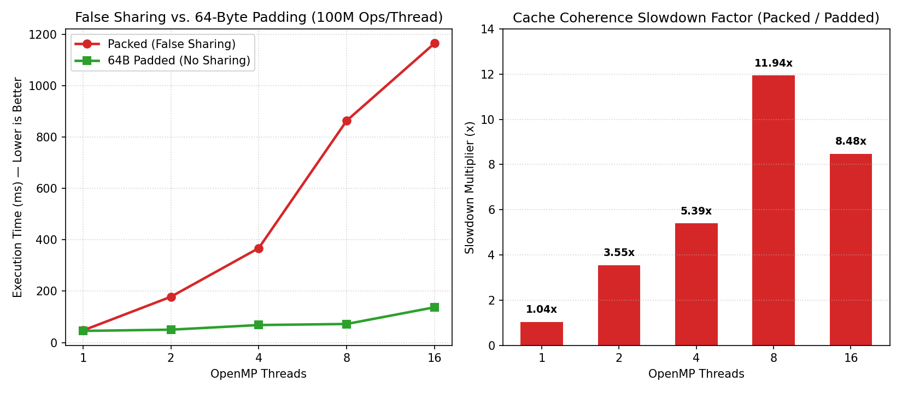

# Experiment 10: False Sharing & Cache Coherence (MESI/MOESI)

## 1. Goal
Measure the performance penalty of **false sharing** on the **AMD Ryzen 9 8940HX** by comparing multi-threaded increments to adjacent 8-byte counters (sharing a 64-byte cache line) against 64-byte padded counters (each occupying its own private cache line).

## 2. COA Concepts
- **64-Byte Cache Lines:** Modern x86-64 CPUs fetch and maintain coherence at 64-byte granularity, not per individual variable.
- **False Sharing:** When multiple cores write to *different* variables that happen to reside on the *same* 64-byte cache line, the hardware cache coherence protocol (MESI/MOESI) repeatedly invalidates the line in other cores' L1 caches, forcing expensive cross-core cache-line transfers ("ping-ponging").
- **Cache-Line Padding:** Aligning each thread's counter to 64 bytes (`__attribute__((aligned(64)))` + 56 bytes of padding) isolates each core's writes to its own cache line and eliminates coherence traffic.

## 3. Commands

    # Compile with OpenMP
    gcc -O3 -fopenmp false_sharing.c -o false_sharing

    # Run benchmark and save results
    ./false_sharing | tee results.csv

    # Generate comparison chart
    python3 plot_false_sharing.py

## 4. Results

| OpenMP Threads | Packed (ms) | 64B Padded (ms) | Slowdown Factor |
| :--- | :--- | :--- | :--- |
| **1** | 47.036 | 45.325 | 1.04× |
| **2** | 178.128 | 50.124 | 3.55× |
| **4** | 367.588 | 68.155 | 5.39× |
| **8** | 863.315 | 72.298 | **11.94×** |
| **16** | 1164.513 | 137.247 | 8.48× |

## 5. Architectural Analysis
- **1 Thread Baseline:** Packed (`47.04 ms`) and padded (`45.33 ms`) perform identically (**1.04×**) because no other core contests the cache line.
- **Peak Contention at 8 Threads (11.94× Slowdown):** Since each `long long` counter is 8 bytes, **8 counters fit into exactly one 64-byte cache line**. All 8 cores hammer that single line simultaneously, maximizing MESI/MOESI invalidation traffic (`863.32 ms` vs. `72.30 ms`).
- **16 Threads (8.48× Slowdown):** Threads 0–7 contend on cache line 0 while threads 8–15 contend on cache line 1, while all-core boost clocks dip slightly on the padded run (`137.25 ms`).
