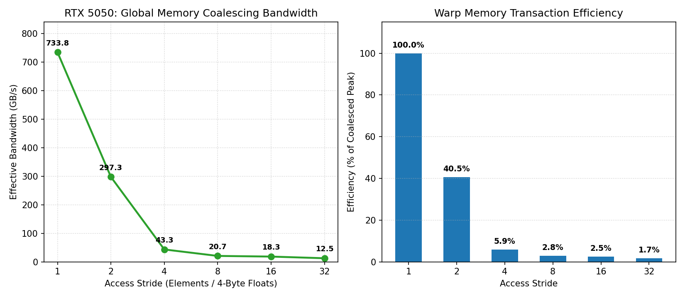

# Experiment 11: GPU Global Memory Coalescing

## 1. Goal
Measure how strided global memory access patterns degrade effective VRAM bandwidth on the **NVIDIA RTX 5050 Laptop GPU** by sweeping access strides from `1` (fully coalesced) to `32` (fully uncoalesced) across 2M float elements.

## 2. COA Concepts
- **Warp Memory Coalescing:** GPU threads execute in 32-thread warps and fetch global memory in 32-byte sectors / 128-byte cache lines. When threads access consecutive 4-byte floats (`stride = 1`), all 32 requests merge into a single 128-byte transaction.
- **Strided Access & Sector Waste:** Increasing the stride spreads a warp's 32 accesses across multiple cache lines and sectors, forcing the memory controller to issue many separate transactions while discarding unused bytes in each fetched line.
- **L2 Cache Footprint:** Compact coalesced working sets (`16 MB`) fit well within the GPU's on-chip L2 cache, whereas larger strides expand the touched address space and spill directly to off-chip VRAM.

## 3. Commands

    # Compile CUDA benchmark
    nvcc -O3 coalescing.cu -o coalescing

    # Run benchmark and save results
    ./coalescing | tee results.csv

    # Generate bandwidth & efficiency chart
    python3 plot_coalescing.py

## 4. Results

| Access Stride | Time (ms) | Effective Bandwidth (GB/s) | Efficiency (% of Peak) |
| :--- | :--- | :--- | :--- |
| **1** | **0.0229** | **733.83** | **100.0%** |
| **2** | 0.0564 | 297.32 | 40.5% |
| **4** | 0.3874 | 43.30 | 5.9% |
| **8** | 0.8121 | 20.66 | 2.8% |
| **16** | 0.9148 | 18.34 | 2.5% |
| **32** | 1.3382 | 12.54 | 1.7% |

## 5. Architectural Analysis
- **Peak Coalesced Throughput (Stride 1):** Hits **733.83 GB/s** (`0.0229 ms`) as every warp coalesces into a single 128-byte transaction and benefits from high L2 cache hit rates.
- **L2 Spill & Half-Line Waste (Stride 2):** Effective bandwidth drops to **297.32 GB/s** (`40.5%`) as half of every fetched line goes unused and the working set doubles.
- **58.5× Bandwidth Collapse (Stride 32):** At `stride = 32`, every thread in a warp lands in a separate 128-byte cache line, collapsing effective bandwidth to **12.54 GB/s** (**1.7%** efficiency) and wasting **98.3%** of peak throughput.
