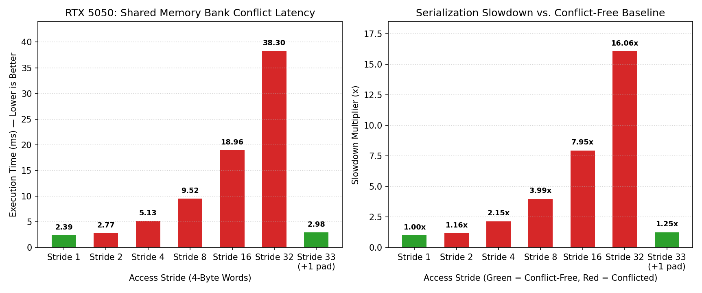

# Experiment 12: GPU Shared Memory Bank Conflicts

## 1. Goal
Measure the serialization penalty of **shared memory bank conflicts** on the **NVIDIA RTX 5050 Laptop GPU** by sweeping access strides from `1` (conflict-free) through `32` (32-way conflict), and verify the classic `+1` padding fix (`stride = 33`).

## 2. COA Concepts
- **32 Shared Memory Banks:** On-chip `__shared__` memory is organized into 32 parallel 4-byte-wide banks, matching the 32 threads in a warp. When each thread accesses a different bank (`stride = 1`), all 32 reads complete in a single cycle.
- **N-Way Bank Conflicts:** When multiple threads in a warp access *different* addresses mapped to the *same* bank (`stride = 2, 4, 8, 16, 32`), the hardware serializes the accesses. At `stride = 32`, all 32 threads hit Bank 0, causing a full 32-way conflict.
- **The `+1` Padding Fix (`stride = 33`):** Since $\gcd(33, 32) = 1$, adding 1 extra element to the stride redistributes every thread in the warp back to a unique bank, eliminating bank conflicts.

## 3. Commands

    # Compile CUDA benchmark
    nvcc -O3 bank_conflicts.cu -o bank_conflicts

    # Run benchmark and save results
    ./bank_conflicts | tee results.csv

    # Generate comparison chart
    python3 plot_bank_conflicts.py

## 4. Results

| Access Stride | Conflict Way | Time (ms) | Slowdown vs. Baseline |
| :--- | :--- | :--- | :--- |
| **1** | 1-way (Conflict-Free) | **2.3852** | **1.00×** |
| **2** | 2-way | 2.7661 | 1.16× |
| **4** | 4-way | 5.1345 | 2.15× |
| **8** | 8-way | 9.5155 | 3.99× |
| **16** | 16-way | 18.9564 | 7.95× |
| **32** | 32-way (All hit Bank 0) | **38.3042** | **16.06×** |
| **33 (+1 pad)** | 1-way (Conflict-Free) | **2.9761** | **1.25×** |

## 5. Architectural Analysis
- **Linear Serialization Scaling:** From `stride = 4` to `32`, execution time doubles at every power-of-two step (`2.15× → 3.99× → 7.95× → 16.06×`), directly exposing the hardware's serialized bank-conflict replay mechanism.
- **32-Way Peak Penalty:** At `stride = 32`, shared memory throughput drops by **16.06×** (`38.3042 ms` vs. `2.3852 ms`).
- **Padding Recovery:** Switching from `stride = 32` to `stride = 33` recovers **12.9×** of the lost speed (`38.30 ms → 2.98 ms`), proving why matrix-transpose and tiled CUDA kernels pad shared memory arrays by `+1` column.
