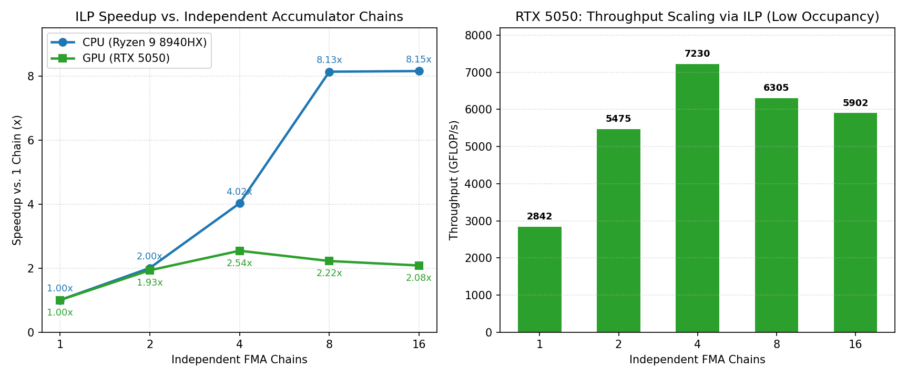

# Experiment 13: ILP & Out-of-Order Execution (CPU vs. GPU)

## 1. Goal
Measure **Instruction-Level Parallelism (ILP)** on the **AMD Ryzen 9 8940HX** (scalar, `-fno-tree-vectorize`) and **NVIDIA RTX 5050 Laptop GPU** (low occupancy: 32 threads/block) by breaking a single FMA dependency chain into `1, 2, 4, 8, 16` independent accumulator chains performing the exact same total FLOPs.

## 2. COA Concepts
- **Pipeline Latency & RAW Hazards:** A floating-point FMA (`a = a * m + c`) has a multi-cycle pipeline latency (~4 cycles). A single accumulator creates a strict Read-After-Write (RAW) dependency chain, stalling execution units.
- **Out-of-Order (OoO) Execution (CPU):** Breaking the chain into multiple independent accumulators lets Zen 4's OoO scheduler keep both FMA pipes full simultaneously (`2 pipes × 4-cycle latency = 8 FMAs in flight`).
- **Warp-Level ILP vs. Register Pressure (GPU):** At low occupancy, independent chains hide FMA latency within each warp until extra accumulators increase register pressure and slightly reduce efficiency.

## 3. Commands

    # Compile & run scalar CPU ILP benchmark
    gcc -O3 -march=native -fno-tree-vectorize ilp_cpu.c -o ilp_cpu
    ./ilp_cpu | tee results_cpu.csv

    # Compile & run GPU ILP benchmark
    nvcc -O3 ilp_gpu.cu -o ilp_gpu
    ./ilp_gpu | tee results_gpu.csv

    # Generate comparison chart
    python3 plot_ilp.py

## 4. Results

| Chains | CPU Time (ms) | CPU GFLOP/s | CPU Speedup | GPU Time (ms) | GPU GFLOP/s | GPU Speedup |
| :--- | :--- | :--- | :--- | :--- | :--- | :--- |
| **1** | 680.533 | 1.18 | 1.00× | 2.883 | 2841.76 | 1.00× |
| **2** | 340.762 | 2.35 | 2.00× | 1.496 | 5475.00 | 1.93× |
| **4** | 169.247 | 4.73 | 4.02× | **1.133** | **7230.00** | **2.54×** |
| **8** | 83.717 | 9.56 | 8.13× | 1.299 | 6304.95 | 2.22× |
| **16** | **83.494** | **9.58** | **8.15×** | 1.388 | 5901.61 | 2.08× |

## 5. Architectural Analysis
- **CPU Pipeline Saturation at 8 Chains:** Throughput scales linearly from `1` → `8` chains (**8.13×**, `1.18 → 9.56 GFLOP/s`) and plateaus at `16` (`8.15×`), directly exposing Zen 4's **2 FMA units × 4-cycle latency** capacity.
- **GPU Peak at 4 Chains (7.23 TFLOP/s):** Breaking the dependency chain yields a **2.54×** speedup (`2.88 → 1.13 ms`), peaking at **7,230 GFLOP/s**. Beyond 4 chains (`8` and `16`), performance dips slightly (`2.22×` / `2.08×`) due to higher per-thread register pressure.
