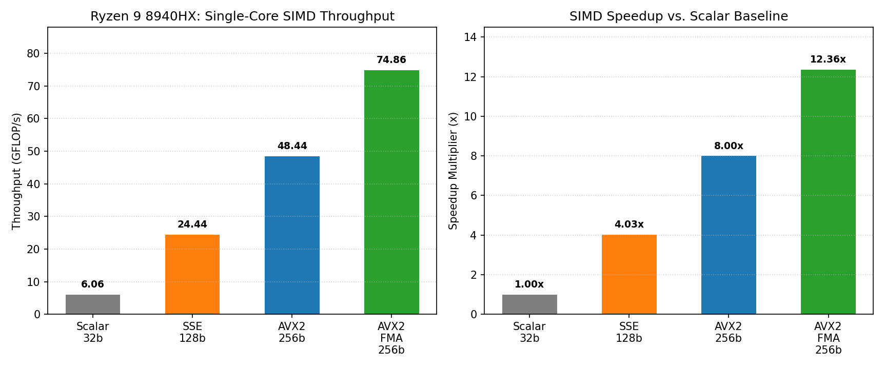

# Experiment 14: SIMD Scaling (Scalar → SSE → AVX2 → AVX2+FMA)

## 1. Goal
Measure single-core **Data-Level Parallelism (SIMD)** on the **AMD Ryzen 9 8940HX** by executing the exact same 6.4 billion floating-point operations (3.2B FMAs) across four progressively wider x86-64 execution modes while keeping 8 independent accumulators to eliminate pipeline latency stalls.

## 2. COA Concepts
- **Scalar (32-bit, 1-wide):** Processes 1 single-precision float per instruction with separate multiply and add instructions (`-fno-tree-vectorize`, `fp-contract=off`).
- **SSE (128-bit `xmm`, 4-wide):** Packs 4 floats per register (`_mm_mul_ps` + `_mm_add_ps`), quadrupling arithmetic throughput per instruction.
- **AVX2 (256-bit `ymm`, 8-wide):** Doubles vector width to 8 floats per register (`_mm256_mul_ps` + `_mm256_add_ps`).
- **AVX2 + FMA (256-bit fused):** Fuses multiply and add into a single `_mm256_fmadd_ps` (`vfmadd231ps`) instruction, reducing instruction issue pressure and increasing peak single-core FLOP/s.

## 3. Commands

    # Compile with AVX2 and FMA intrinsics enabled
    gcc -O3 -mavx2 -mfma simd_scaling.c -o simd_scaling

    # Run benchmark and save results
    ./simd_scaling | tee results.csv

    # Generate comparison chart
    python3 plot_simd.py

## 4. Results

| Execution Mode | Vector Width (Lanes) | Time (ms) | Throughput (GFLOP/s) | Speedup vs. Scalar |
| :--- | :--- | :--- | :--- | :--- |
| **Scalar_32b** | 1 float (32-bit) | 1056.322 | 6.06 | 1.00× |
| **SSE_128b** | 4 floats (128-bit) | 261.883 | 24.44 | 4.03× |
| **AVX2_256b** | 8 floats (256-bit) | 132.114 | 48.44 | 8.00× |
| **AVX2_FMA_256b** | 8 floats (256-bit fused) | **85.496** | **74.86** | **12.36×** |

## 5. Architectural Analysis
- **Exact Lane-Width Scaling:** Widening from Scalar → SSE yields **4.03×** (`6.06 → 24.44 GFLOP/s`), and widening to AVX2 hits an exact **8.00×** (`48.44 GFLOP/s`), proving the 8-accumulator loop completely hides pipeline latency.
- **FMA Fusion Gain (12.36×):** Fusing multiply and add into `vfmadd231ps` pushes a single Zen 4 core to **74.86 GFLOP/s** (**1.55×** over unfused AVX2). Because Zen 4 can already overlap separate `vmulps` and `vaddps` across its floating-point execution pipes, unfused AVX2 runs above half of FMA peak, while FMA unlocks the remaining throughput ceiling.
