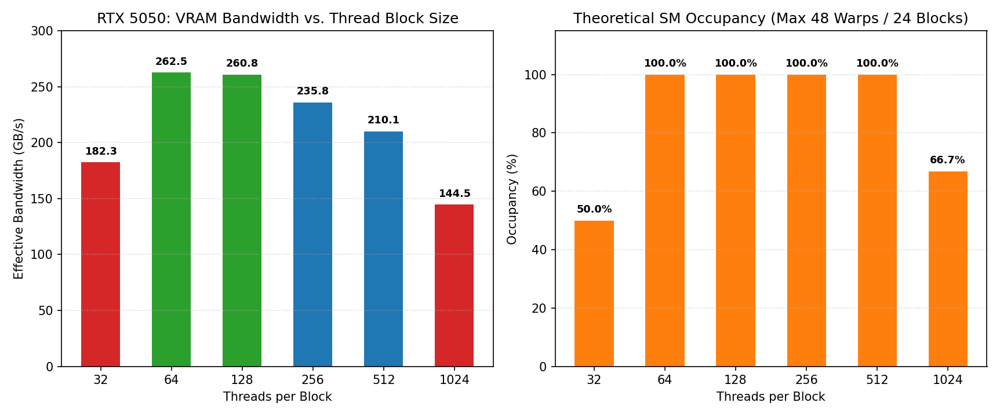

# Experiment 15: GPU Occupancy & Thread Block Sizing

## 1. Goal
Measure how thread block size (`32` to `1024` threads/block) affects **theoretical SM occupancy** and **effective VRAM bandwidth** on the **NVIDIA RTX 5050 Laptop GPU** using a memory-bound SAXPY kernel over 32M floats (`384 MB` total traffic per run).

## 2. COA Concepts
- **SM Warp & Block Limits:** Each Blackwell SM supports at most **48 resident warps (1536 threads)** and **24 resident blocks**.
- **Latency Hiding via Occupancy:** High warp occupancy lets the SM's warp schedulers switch to ready warps whenever active warps stall on ~300–500 cycle VRAM fetches.
- **Block-Count & Divisibility Bottlenecks:** Very small blocks (`32`) hit the 24-block/SM cap before filling all warp slots (`50.0%` occupancy), while oversized blocks (`1024`) cannot divide evenly into 1536 threads (`1 block = 66.7%` occupancy).

## 3. Commands

    # Compile CUDA benchmark
    nvcc -O3 occupancy.cu -o occupancy

    # Run benchmark and save results
    ./occupancy | tee results.csv

    # Generate occupancy & bandwidth chart
    python3 plot_occupancy.py

## 4. Results

| Block Size | Active Blocks / SM | Active Warps / SM | Theoretical Occupancy | Time (ms) | Effective Bandwidth (GB/s) |
| :--- | :--- | :--- | :--- | :--- | :--- |
| **32** | 24 | 24 | 50.0% | 2.2083 | 182.33 |
| **64** | **24** | **48** | **100.0%** | **1.5339** | **262.51** |
| **128** | **12** | **48** | **100.0%** | **1.5441** | **260.77** |
| **256** | 6 | 48 | 100.0% | 1.7079 | 235.76 |
| **512** | 3 | 48 | 100.0% | 1.9163 | 210.13 |
| **1024** | 1 | 32 | 66.7% | 2.7857 | 144.54 |

## 5. Architectural Analysis
- **Block-Cap Starvation (`block_size = 32`):** Hits the 24-block/SM ceiling with only 24 warps active (`50.0%`), capping bandwidth at **182.33 GB/s**.
- **Peak Sweet Spot (`64` & `128`):** Reaches **100.0% occupancy** (48 warps/SM) with high block concurrency, saturating VRAM at **262.51 GB/s** (`1.5339 ms`).
- **Tail-Effect & Divisibility Penalty (`1024`):** Only 1 block fits per SM (`1024 ≤ 1536`), dropping occupancy to **66.7%** and cutting effective bandwidth by **45%** down to **144.54 GB/s**.
