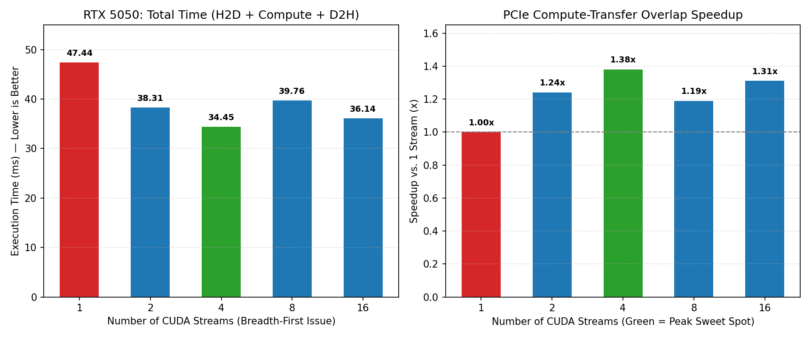

# Experiment 16: CUDA Streams & PCIe Compute-Transfer Overlap

## 1. Goal
Measure how asynchronous **CUDA streams** with pinned host memory (`cudaMallocHost`) hide PCIe transfer latency on the **NVIDIA RTX 5050 Laptop GPU** by overlapping Host-to-Device (`H2D`), kernel compute, and Device-to-Host (`D2H`) operations across `1, 2, 4, 8, 16` streams (`32M` floats = `128 MB` per buffer).

## 2. COA Concepts
- **Pinned Host Memory & Async DMA:** `cudaMallocHost` allocates page-locked RAM so the GPU's DMA Copy Engines can transfer data over PCIe without CPU staging copies.
- **Depth-First vs. Breadth-First Issuing:** Queuing `H2D → Kernel → D2H` per stream (depth-first) causes false serialization on consumer GPUs/WDDM because `D2H[0]` blocks `H2D[1]` in the copy engine queue. Issuing all `H2D`s, then all `Kernel`s, then all `D2H`s (breadth-first) with `cudaStreamNonBlocking` unlocks true hardware overlap.
- **Pipeline Sweet Spot:** Splitting work into 4 chunks balances DMA/SM concurrency against stream launch and WDDM command-queue overhead.

## 3. Commands

    # Compile CUDA streams benchmark
    nvcc -O3 streams_overlap.cu -o streams_overlap

    # Run benchmark and save results
    ./streams_overlap | tee results.csv

    # Generate overlap speedup chart
    python3 plot_streams.py

## 4. Results

| CUDA Streams | Total Time (ms) | Speedup vs. 1 Stream |
| :--- | :--- | :--- |
| **1** | 47.435 | 1.00× |
| **2** | 38.310 | 1.24× |
| **4** | **34.450** | **1.38×** |
| **8** | 39.757 | 1.19× |
| **16** | 36.142 | 1.31× |

## 5. Architectural Analysis
- **Sequential Baseline (`1` Stream, `47.435 ms`):** Executes `H2D (~10 ms) + Compute (~27 ms) + D2H (~10 ms)` back-to-back with zero overlap.
- **Peak Overlap (`4` Streams, `34.450 ms`, `1.38×`):** Hides **13.0 ms** of PCIe transfer latency by pipelining DMA transfers concurrently with SM execution.
- **Diminishing Returns (`8` & `16` Streams):** Smaller chunks (`8–16 MB`) introduce extra WDDM/WSL2 command-queue scheduling overhead, slightly reducing net speedup (`1.19×` / `1.31×`).
