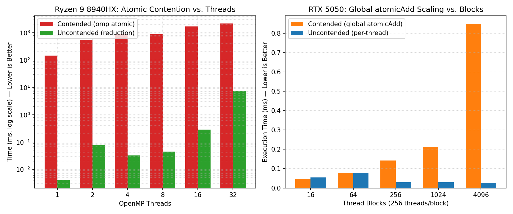

# Experiment 17: Atomic Contention & Lock Scaling (CPU vs. GPU)

## 1. Goal
Measure synchronization overhead when multiple threads update a shared counter concurrently versus accumulating into uncontended/private state on the **AMD Ryzen 9 8940HX** (OpenMP `#pragma omp atomic` vs. `reduction`) and **NVIDIA RTX 5050 Laptop GPU** (global `atomicAdd` vs. per-thread accumulation).

## 2. COA Concepts
- **Cache-Line Contention & Coherence Traffic (CPU):** Shared atomic updates force exclusive cache-line ownership transitions across cores/CCDs, serializing progress and scaling poorly as OpenMP thread count increases (`1` to `32` threads).
- **Private / Reduction State:** Accumulating locally or via OpenMP `reduction(+:global_sum)` avoids shared-line contention until a single final combine step.
- **Global Atomic Serialization (GPU):** Many concurrent thread blocks targeting one global `atomicAdd` address serialize through memory/L2 atomic handling, whereas per-thread execution scales without contention.

## 3. Commands

    # Compile and run CPU OpenMP atomic benchmark
    gcc -O3 -fopenmp atomics_cpu.c -o atomics_cpu
    ./atomics_cpu | tee results_cpu.csv

    # Compile and run GPU CUDA atomic benchmark
    nvcc -O3 atomics_gpu.cu -o atomics_gpu
    ./atomics_gpu | tee results_gpu.csv

    # Generate comparison chart
    python3 plot_atomics.py

## 4. Results

### CPU (Ryzen 9 8940HX — 40,000,000 Total Increments)

| Threads | Contended (ms) | Uncontended (ms) | Contention Slowdown |
| :--- | :--- | :--- | :--- |
| **1** | 147.484 | 0.004 | 36442.74× |
| **2** | 551.465 | 0.076 | 7227.21× |
| **4** | 887.309 | 0.032 | 27375.95× |
| **8** | 892.941 | 0.045 | 19889.55× |
| **16** | 1700.282 | 0.284 | 5995.42× |
| **32** | 2166.973 | 7.483 | 289.58× |

### GPU (RTX 5050 — 64M Increments Across Blocks of 256 Threads)

| Blocks | Total Threads | Contended (ms) | Uncontended (ms) | Contention Slowdown |
| :--- | :--- | :--- | :--- | :--- |
| **16** | 4,096 | 0.0472 | 0.0551 | 0.86× |
| **64** | 16,384 | 0.0783 | 0.0778 | 1.01× |
| **256** | 65,536 | 0.1421 | 0.0295 | 4.82× |
| **1024** | 262,144 | 0.2135 | 0.0308 | 6.94× |
| **4096** | 1,048,576 | 0.8481 | 0.0251 | **33.76×** |

## 5. Architectural Analysis
- **CPU Contention Grows with Thread Count:** Contended `omp atomic` rises from `147.484 ms` (1 thread) to `2166.973 ms` (32 threads) as cross-core synchronization and cache-line contention compound, while uncontended `reduction` completes in `0.004–7.483 ms`.
- **GPU High-Block Contention Spike:** Up to `64` blocks (`16,384` threads), contended and uncontended runtimes are nearly identical (`~0.05–0.08 ms`). At `4,096` blocks (`1,048,576` threads), single-address global `atomicAdd` contention pushes runtime to `0.8481 ms` vs. `0.0251 ms` uncontended (**33.76×** slower).
