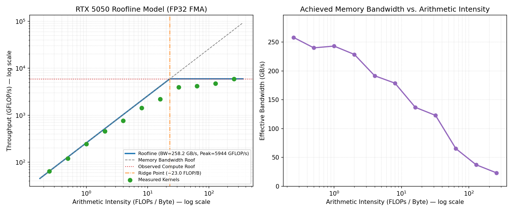

# Experiment 18: Roofline Model (Arithmetic Intensity vs. Compute & Memory Bound)

## 1. Goal
Map how **Arithmetic Intensity** (`0.25` to `256.00` FLOPs/byte across `1` to `1024` FP32 FMA iterations over `16M` floats = `64 MB` input/output buffers) governs performance ceilings on the **NVIDIA GeForce RTX 5050 Laptop GPU**.

## 2. COA Concepts
- **Arithmetic Intensity (AI):** Ratio of floating-point operations performed to bytes transferred from memory (`2 * fma_steps` FLOPs per `8` bytes streamed per float element).
- **Memory-Bound Regime:** At low AI, execution time is gated by memory bandwidth—adding math steps within the latency budget increases GFLOP/s almost proportionally without inflating runtime.
- **Ridge Point & Compute-Bound Regime:** Once AI exceeds the hardware ridge point (`Compute Peak / Bandwidth Peak`), runtime scales with arithmetic work and throughput approaches the SM compute ceiling.

## 3. Commands

    # Compile CUDA Roofline benchmark
    nvcc -O3 roofline.cu -o roofline

    # Run benchmark and save results
    ./roofline | tee results.csv

    # Plot Roofline model and bandwidth curve
    python3 plot_roofline.py

## 4. Results

| FMA Steps | Arithmetic Intensity (FLOPs/Byte) | Time (ms) | Throughput (GFLOP/s) | Achieved Bandwidth (GB/s) |
| :--- | :--- | :--- | :--- | :--- |
| **1** | 0.25 | 0.5198 | 64.55 | **258.19** |
| **2** | 0.50 | 0.5591 | 120.02 | 240.04 |
| **4** | 1.00 | 0.5522 | 243.08 | 243.08 |
| **8** | 2.00 | 0.5871 | 457.23 | 228.61 |
| **16** | 4.00 | 0.7004 | 766.47 | 191.62 |
| **32** | 8.00 | 0.7507 | 1430.24 | 178.78 |
| **64** | 16.00 | 0.9802 | 2190.78 | 136.92 |
| **128** | 32.00 | 1.0927 | 3930.54 | 122.83 |
| **256** | 64.00 | 2.0575 | 4174.86 | 65.23 |
| **512** | 128.00 | 3.6092 | 4760.00 | 37.19 |
| **1024** | 256.00 | 5.7803 | **5944.31** | 23.22 |

## 5. Architectural Analysis
- **Memory-Bound Floor (`AI = 0.25–2.00`):** Time stays near `~0.52–0.59 ms` and bandwidth peaks at **258.19 GB/s**, while GFLOP/s rises from `64.55` to `457.23 GFLOP/s`.
- **Compute-Bound Climb (`AI = 64.00–256.00`):** Runtime grows nearly linearly with FMA count (`2.0575 ms → 5.7803 ms`), pushing sustained kernel throughput to **5944.31 GFLOP/s** as achieved bandwidth drops to **23.22 GB/s**.
