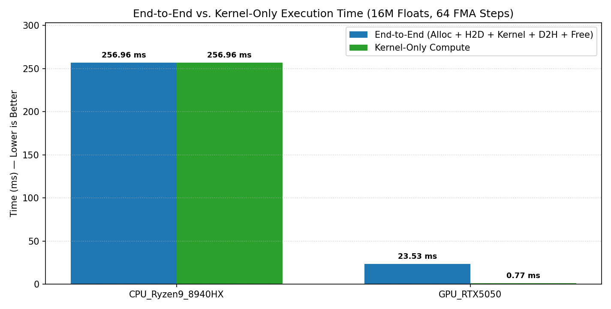

# Experiment 19: End-to-End Workload Comparison (CPU vs. GPU)

## 1. Goal
Compare full end-to-end wall-clock runtime versus pure compute/kernel runtime between the **AMD Ryzen 9 8940HX** (OpenMP) and **NVIDIA GeForce RTX 5050 Laptop GPU** (CUDA) over `16M` floats (`64 MB` per array, `64` FMA iterations per element).

## 2. COA Concepts
- **Data Movement & Setup Overhead:** GPU execution includes device memory allocation (`cudaMalloc`), Host-to-Device (`H2D`) PCIe transfer, kernel launch/execution, Device-to-Host (`D2H`) transfer, and `cudaFree`.
- **Amortization vs. Transfer Tax:** Pure compute speedup (`335.92×`) is much larger than end-to-end speedup (`10.92×`) because PCIe transfers and allocation take ~22.76 ms while the kernel itself takes only 0.765 ms.

## 3. Commands

    # Compile CPU and GPU benchmarks
    gcc -O3 -fopenmp -lm e2e_cpu.c -o e2e_cpu
    nvcc -O3 e2e_gpu.cu -o e2e_gpu

    # Run and capture results
    ./e2e_cpu > results.csv
    ./e2e_gpu >> results.csv

    # Plot comparison chart
    python3 plot_e2e.py

## 4. Results

| Platform | End-to-End Time (ms) | Kernel-Only Time (ms) | E2E Speedup vs. CPU | Kernel Speedup vs. CPU |
| :--- | :--- | :--- | :--- | :--- |
| **CPU (Ryzen 9 8940HX)** | 256.965 | 256.965 | 1.00× | 1.00× |
| **GPU (RTX 5050)** | **23.526** | **0.765** | **10.92×** | **335.92×** |

## 5. Architectural Analysis
- **Compute Dominance:** On the 64-FMA loop over 16M elements, the RTX 5050 kernel finishes in `0.765 ms` vs. `256.965 ms` on the CPU.
- **PCIe Overhead Share:** Roughly **96.7%** of the GPU's `23.526 ms` end-to-end wall time (`~22.76 ms`) comes from allocation, H2D/D2H transfers, and teardown rather than SM math—highlighting why keeping data resident on-device or increasing arithmetic work per transfer is critical in real pipelines.
