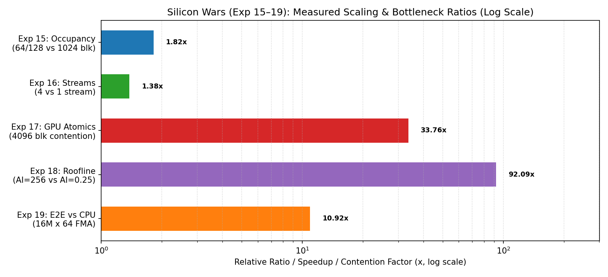

# Experiment 20: Hardware Architecture Synthesis & Workload Decision Matrix

## 1. Goal
Synthesize empirical findings across the **Silicon Wars** benchmark suite on the **AMD Ryzen 9 8940HX** (16 cores / 32 threads, AVX2, OpenMP) and **NVIDIA GeForce RTX 5050 Laptop GPU** (Blackwell, CUDA) into an actionable microarchitecture decision guide.

## 2. COA Concepts
- **Bottleneck-Driven Selection:** Optimal execution depends on whether a workload is latency-bound, memory-bandwidth-bound, compute-bound, PCIe-transfer-bound, or synchronization-bound.
- **System-Level Tradeoffs:** High raw SM compute or SIMD throughput can be eroded by poor occupancy, uncoalesced memory, global atomic contention, or unamortized PCIe round-trips.

## 3. Commands

    # Compile and run synthesis table generator
    gcc -O3 synthesis.c -o synthesis
    ./synthesis | tee results.csv

    # Plot synthesis summary chart
    python3 plot_synthesis.py

## 4. Results

| Workload / Regime | Preferred Choice | Measured Benchmark Signal | Architectural Rule |
| :--- | :--- | :--- | :--- |
| **Low-AI Streaming** | Bandwidth-aware / CPU low-latency | `0.25–2.00` FLOPs/byte in Exp 18 | Memory bandwidth caps throughput before compute roof is reached |
| **High-AI Compute** | **GPU (RTX 5050)** | Up to **5944.31 GFLOP/s** at `AI = 256` (Exp 18) | High math-to-byte ratio saturates parallel execution units |
| **Shared Atomic Contention** | Privatize / Reduce (avoid shared locks) | **33.76×** GPU contention (4096 blocks); high CPU slowdown (Exp 17) | Eliminate hot-address atomics via local accumulation + reduction |
| **PCIe Data + Compute** | **GPU + Breadth-First Async Streams** | **1.38×** speedup at `4` streams vs. `1` stream (Exp 16) | Overlap DMA transfers with kernel compute using pinned memory |
| **End-to-End Pipeline** | **GPU (RTX 5050)** for heavy batches | **23.526 ms** E2E (`10.92×` vs. `256.965 ms` CPU; `0.765 ms` kernel) (Exp 19) | Amortize `cudaMalloc` + H2D/D2H overhead with sufficient compute |

## 5. Architectural Decision Checklist
1. **Check Arithmetic Intensity first:** Low FLOPs/byte points to memory bandwidth limits; high FLOPs/byte favors parallel compute.
2. **Eliminate shared-state bottlenecks:** Prefer thread-local/block-local accumulation over contended atomics on both CPU and GPU.
3. **Measure end-to-end, not just kernels:** Always account for host-device copies, occupancy (`64–128` threads/block sweet spot in Exp 15), and stream overlap (`4` streams in Exp 16).
